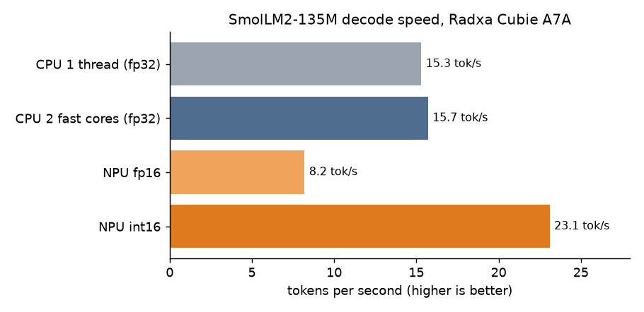

# SmolLM2-135M-Instruct chat on the Radxa Cubie A7A NPU

A small language model, [SmolLM2-135M-Instruct](https://huggingface.co/HuggingFaceTB/SmolLM2-135M-Instruct), generating text on the Allwinner A733 NPU at about **23 tokens/s**. The board's own CPU does about 15.7 tokens/s with the same graph. It's a 135M-parameter model, so don't expect smart answers; the point was to find out whether an LLM can run on this NPU at all. It can, and the answers match the float model.

```
you> What is the capital of Japan?
bot> The capital of Japan is Tokyo.
   [7 tokens, 22.7 tok/s on NPU, context 34/127]
you> And what language do they speak there?
bot> Japanese is the official language of Japan.
```

(That is a real run from `scripts/chat.py`; it keeps the conversation in the KV cache, so "they" works.)

## Results

Radxa Cubie A7A, decode speed (one token at a time, context 128, greedy or lightly sampled).

| | tokens/s | per token | output |
|---|---|---|---|
| **NPU int16** (223 MB) | **23** | 43 ms | matches float on my test prompts |
| NPU fp16 (272 MB, no calibration needed) | 8.2 | 122 ms | correct, but slower than the CPU |
| CPU, 1 thread (onnxruntime fp32, same graph) | 15.3 | 65 ms | reference |
| CPU, 2 fast cores | 15.7 | 64 ms | reference |
| CPU, 4 threads | 13.8 | 73 ms | reference |



An Intel i3-1005G1 laptop does 38 tokens/s on the same graph (2 threads), so this is not a speed record. The gain over the board's CPU is only about 1.5x. My guess is that decoding mostly waits on reading the weights from memory rather than on compute (the int16 model reads about 5 GB/s, the fp16 one only about 2), but I didn't measure that.

Quality check: I only ran a handful of prompts. "What is the capital of France?" gives "The capital of France is Paris." exactly like the float model, the "three primary colours" answer is word-for-word the float answer, and the "why is the sky blue" answer is coherent but words differ from float after a while. No benchmark numbers (perplexity etc.), so treat this as a sanity check, not an evaluation.

The `.nb` (223 MB) and `embed.f32` (113 MB) are in the [GitHub release](../../releases) because they are too big for the repo. `models/` has `prefix.bin`, the norm scales and the Acuity metadata.

## What I used

- **Board:** Radxa Cubie A7A (Allwinner A733, 8x Cortex-A55, VeriSilicon Vivante NPU), Debian 11, kernel 5.15.147-a733. The NPU is driven through VIPLite with the `awnn_inference` wrapper that was already installed on my board (`~/awnn_inference`).
- **Converter:** the NPU toolchain docker image `ubuntu-npu:v2.0.10.1` (Acuity 6.30.22 + Vivante IDE 5.11), for the Allwinner A733 NPU. I didn't build it and I'm not redistributing it, so check Radxa's NPU documentation for where to get it. Everything below that says "in the container" runs there, with this repo mounted at `/workspace/mp` (for example `docker run -v $PWD:/workspace/mp ...`). The scripts assume that path.
- **Tools on the board:** `scripts/nb_bench.cpp` is a small timing / smoke-test program I wrote for `.nb` files. Build it on the board:

```
g++ -O2 -std=c++14 -pthread scripts/nb_bench.cpp -I ~/awnn_inference/include -L ~/awnn_inference/install/lib \
    -lawnn_inference -lNBGlinker -lVIPhal -Wl,-rpath,$HOME/awnn_inference/install/lib -o ~/nb_bench/nb_bench
export LD_LIBRARY_PATH=$HOME/awnn_inference/install/lib
~/nb_bench/nb_bench -m model.nb -n 100                      # latency with random input
~/nb_bench/nb_bench -m model.nb -n 1 -i0 input.bin -o out.bin   # real input (raw bytes), outputs saved as float32 (out.bin, out.bin.1, ...)
```

`scripts/board_eval.sh` wraps that: copy a model and a folder of `*.in.bin` files to the board, run them all, copy the outputs back.

## Run the chat on the board

Put these in one folder on the board: `chat.py`, a built `nb_chat`, `smollm2_135m_c128_int16.nb` and `embed.f32` (release), `smollm2_135m_c128_int16.nbg_meta.json` and `prefix.bin` (`models/`), `tokenizer.json` (`scripts/get_model.sh` downloads it with the weights).

```
g++ -O2 -std=c++14 -pthread scripts/nb_chat.cpp -I ~/awnn_inference/include -L ~/awnn_inference/install/lib \
    -lawnn_inference -lNBGlinker -lVIPhal -Wl,-rpath,$HOME/awnn_inference/install/lib -o nb_chat
pip install tokenizers
python3 chat.py
```

Commands: `/reset`, `/temp 0.7`, `/greedy`, `/quit`. Default sampling is temperature 0.7, top-k 40, repetition penalty 1.1. `scripts/nb_llm.cpp` is the simpler one-shot version (feed token ids, print token ids) that I used for testing.

**Limits:** the context is only 127 tokens, 14 of which are the fixed system prompt, so about 5-6 short exchanges before it resets itself. That is a limit I chose when building the graph (below), not a limit of the model. Replies are cut at 120 tokens. Greedy decoding repeats itself on some prompts.

## How it works

Hugging Face's ONNX exports of this model use Microsoft-specific fused ops (`RotaryEmbedding`, `MultiHeadAttention`, `SkipSimplifiedLayerNormalization`), which Acuity can't import. So `scripts/llm_build.py` builds the network myself, straight from `model.safetensors`, out of plain ONNX ops. It builds **one decode step** with static shapes:

- inputs: the embedding of the current token (1x576), `cos`/`sin` for the current position (1x64), an additive attention mask (1x1x1x128), and the whole KV cache as two inputs of shape 1x90x127x64 (30 layers x 3 KV heads; 127 old slots, the new token's K/V is concatenated inside the graph)
- outputs: logits (1x49152) and the new K and V (1x90x1x64 each)
- RMSNorm = Mul/ReduceMean/Sqrt/Div, RoPE = slice/neg/concat, SiLU = x*Sigmoid(x), grouped-query attention done by reshaping the 9 query heads into 3 groups of 3 (no repeat of K/V)

The CPU (`nb_chat.cpp`) does the embedding lookup, builds cos/sin and the mask, copies the KV cache in, runs the network, appends the new K/V to the cache, and picks the next token. Prefill is done token by token with the same graph (about 43 ms/token too).

Why context 128: the shapes are fixed when you compile, and the cache is a model input that gets copied to the NPU every token, so it grows linearly with the context. I picked 128 to keep conversions and debugging quick. A bigger one needs a rebuild and would be slower per token; I haven't tried it.

## How I converted it

1. `scripts/get_model.sh` (weights + tokenizer). Then `python scripts/llm_build.py 128 llm/smol_c128.onnx` builds the float graph and writes `embed.f32`. `python scripts/llm_run.py llm/smol_c128.onnx 128` (onnxruntime) checks that it answers correctly, which is the first thing to do. Needs `numpy onnx onnxruntime tokenizers`.
2. `python scripts/llm_prep2.py` does the preparation:
   - runs the constant 14-token chat prefix (`<|im_start|>system ... <|im_start|>user`) through the float model once and saves its KV cache as `prefix.bin`. **Why:** in float, the very first token has hidden-state values around 25,000 while all other tokens stay near 100. A fixed-point format can't hold both, so the first token never goes through the NPU: the prefix is computed offline and pre-loaded into the cache. This also saves 14 tokens of prefill per conversation.
   - records 47 real decode steps (from 10 short prompts, with the prefix pre-loaded) as the calibration set. Inputs include the whole KV cache, so each sample is about 6 MB.
   - measures the size of the activations entering every RMSNorm and picks a power-of-two scale for each (`rms_scales.json`) so the squares in the norm stay in a sane range; `llm_build.py` then writes the scaled graph `smol_s.onnx`. The scaling cancels out mathematically.
   - the attention mask uses -30, not the usual -1e4. I changed that before ever quantising, on the reasoning that a huge mask value would force a coarse fixed-point scale onto the attention scores; I never tested the -1e4 version.
3. In the container: `python3 scripts/llm_mkh5b.py` (packs the calibration data into one HDF5 file), `bash scripts/llm_import_s.sh`, then `bash scripts/llm_convert_h5.sh c128s i16`. About 12 minutes in total. The result is `llm/c128s/out_i16_nbg_unify/network_binary.nb`.
4. The fixed-point scales of the inputs are in `nbg_meta.json` (`fl`); `chat.py` reads them. The mask input is float16, the others are int16.

I haven't re-tested whether the prefix trick and the norm rescaling are still necessary now that the calibration bug below is fixed. I kept them because everything was already set up, and the 25,000 figure is real.

## Why this took so long (read this if your quantised model is garbage)

My first int16 builds produced complete nonsense ("handinfo horders behalfis--namofautions..."), and I spent hours blaming the quantisation. The actual causes were setup bugs:

1. **`reverse_channel: true` in the input meta** (the default) reverses the last/channel axis of every *tensor* input during calibration and simulation. Calibration saw scrambled data, so every range was wrong. `reverse_channel: false` fixed it. The tell-tale: Acuity's float32 inference matched onnxruntime exactly, but the quantised simulator did not, and the simulator's saved input tensors didn't match my files.
2. **Multiple inputs need an HDF5 database.** The NPY loader supports only one port. A single `.h5` file with one dataset per input name (first axis = samples) works (`type: H5FS`, path = the `.h5` file). I first gave it a *list of* `.h5` files; that failed with "file signature not found", and then the quantize step quietly **kept the old `.quantize` file** and the export went ahead with stale calibration. Check the quantize log and file timestamps.
3. `pegasus inference` shuffles the dataset order. Compare against the input tensors it saved (`iter_N_<input>*.tensor`), not against your list.
4. Debug recipe that worked: float32 Acuity inference vs onnxruntime on the same sample (correlation should be 1.0), then quantised inference, then per-layer correlation of the K/V outputs to see where it falls apart.

Also: a fp16 build (`--dtype float16`, no calibration) works and answers correctly, but at 8 tokens/s is slower than the CPU. I did that one by hand and the script isn't included; the only difference was a different RMSNorm scale (smaller, to avoid squares overflowing fp16).

## Things that cost me time (Acuity / A733 in general)

These are not specific to this model, so if you convert something else you will probably hit them too.

1. **Export for the right chip.** `--optimize VIP9000NANODI_PLUS_PID0X1000003B` is the A733. An older target I tried first (`VIP9A00NANOQI_PID0X10001029`) gave empty `.nb` files and "Fatal model generation error".
2. **Use `pegasus_patched.py`.** The plain `pegasus.py` in my container failed because there was no torch installed. `env.sh` sets `$PEG` to the patched one.
3. **Put the normalisation on the NPU.** In the input meta I set `add_preproc_node: true`, `reverse_channel: false` and per-channel mean/scale, so the board feeds raw uint8 RGB. Same for the output: `add_postproc_node: true` gives you float32 outputs, which is all the wrapper's output reader understands.
4. **`reverse_channel: false` matters.** The generated default is `true`, which silently flips the channel order of the calibration data. For images that just hurts accuracy a bit; for non-image tensors it scrambled everything (see the SmolLM2 repo).
5. **Always compare the quantised simulator with the float model before trusting a `.nb`**, and then compare the board with the simulator. They do not always agree (see the palm detector below).
6. **Quantisation choice is per model.** int8 per-channel (`pcq`) is fast and fine for some networks, wrecks others; `int16` (`dynamic_fixed_point`) is about 1.5-3x slower but usually close to lossless.

## Credits

SmolLM2 by Hugging Face (Apache-2.0). The graph builder reads the original weights directly.

## More models on the Cubie A7A NPU

Same board, same toolchain, same kind of notes:

- [radxa-cubie-a7a-npu-mediapipe-hands](https://github.com/Aseel1206/radxa-cubie-a7a-npu-mediapipe-hands): MediaPipe palm detector + hand landmarks (int8, ~5 ms total)
- [radxa-cubie-a7a-npu-blazeface](https://github.com/Aseel1206/radxa-cubie-a7a-npu-blazeface): MediaPipe BlazeFace face detector (~1 ms)
- [radxa-cubie-a7a-npu-deit-tiny](https://github.com/Aseel1206/radxa-cubie-a7a-npu-deit-tiny): DeiT-tiny vision transformer (14.5 ms int8)
- [radxa-cubie-a7a-npu-depth-anything-v2](https://github.com/Aseel1206/radxa-cubie-a7a-npu-depth-anything-v2): Depth Anything V2 small depth estimation (255 ms int8)
- [fast-acvnet-radxa-npu](https://github.com/Aseel1206/fast-acvnet-radxa-npu): stereo depth

## Licence

The scripts and docs here are MIT (see `LICENSE`). The neural networks are not mine and keep their own licences; check the model card of the original before reusing a converted `.nb`.
